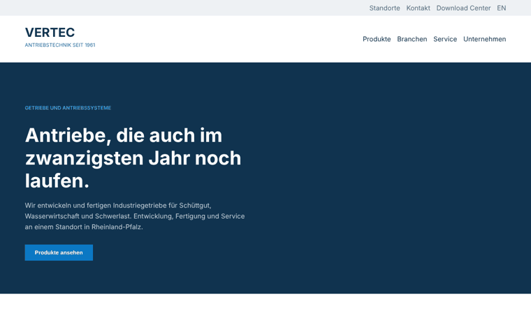
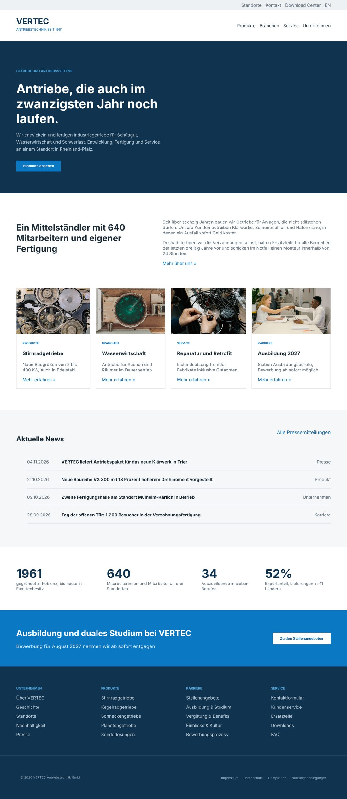

# VERTEC Antriebstechnik



A website for a fictional German industrial company that builds gearboxes and drive systems. Built with plain HTML and CSS, no frameworks and no JavaScript.

VERTEC does not exist. I built this page to practice the layout of a real German B2B company site instead of another generic landing page. All texts and news entries are made up, the photos are from Pexels.

## 🚀 Sections

- **Meta bar and header:** quick links on top, logo with claim and main navigation below.
- **Hero:** dark full-width band with eyebrow label, headline and call to action.
- **About:** headline on the left, two paragraphs on the right.
- **Cards:** four bordered cards with a photo, category label, title and link.
- **News:** list of press entries with date, title and category, each row a separate flex line.
- **Key figures:** four numbers with a short caption below.
- **Career band:** blue band with text on the left and a button on the right.
- **Footer:** four link columns plus a legal bar on a darker background.

## 🛠 Technologies

- **Languages:** HTML5, CSS3
- **Layout:** Flexbox (`justify-content`, `align-items`, `gap`, `flex-direction`)
- **Structure:** semantic elements (`header`, `nav`, `main`, `section`, `footer`), classes instead of IDs
- **Styling:** `max-width` with `margin: 0 auto`, `border-bottom` as separators, `object-fit: cover` for images, `text-transform` with `letter-spacing` for small labels, `:hover` states
- **Font:** Inter (Google Fonts)

## 🎨 Colors

```text
#10334f  Dark blue (hero, footer, logo)
#0b78c4  Blue (buttons, links, career band)
#1c2b36  Body text
#5b6b78  Secondary text
#f5f7f9  Light background (news)
#eef1f4  Meta bar
#dde3e8  Borders and separators
```

## 💻 How to Run

Open `index.html` in a browser. No build step and no dependencies.

## 📝 Still open

- Mobile layout: the page is built for a 1280px desktop view and is not responsive yet.
- Navigation and footer links are placeholders.

## 📷 Full page


